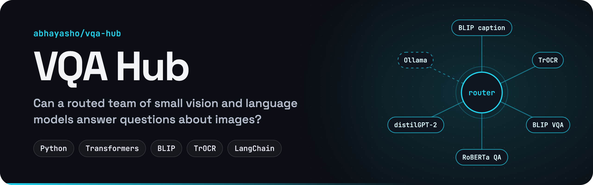
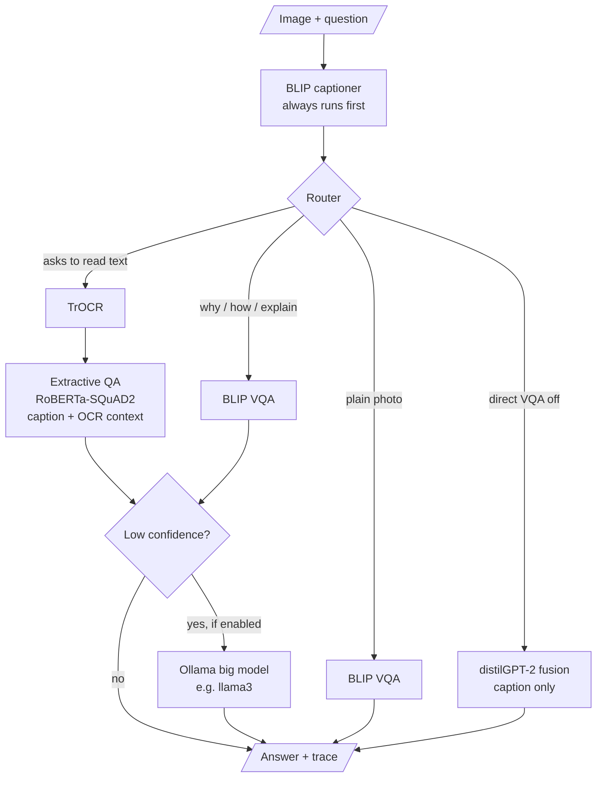

<p align="center">
  
</p>

<p align="center">
  
  
  
  
</p>

**VQA Hub** is a research framework for **visual question answering**. It tests whether a team of small, specialized models (an image captioner, an OCR model, a compact VQA head, an extractive QA reader and a tiny text generator) can work together to rival one large multimodal model. A **hub** routes each question through the right units and records every step, so you can see exactly how an answer was reached.

## Why

- **Accuracy:** can a chain of small models match or beat a large multimodal model on VQA?
- **Cost:** small units are cheaper to run, and only the ones a question needs are called.
- **Interpretability:** each hop leaves a trace (caption, OCR text, intermediate answers) instead of one opaque forward pass.

## How it works



1. **Caption.** `Salesforce/blip-image-captioning-base` describes the image.
2. **Route.** The router reads the question: text-reading cues ("text", "say", "read") go to OCR; reasoning cues ("why", "how", "explain"…) and plain questions go to BLIP's VQA head.
3. **Answer with small units.** For text questions, `microsoft/trocr-base-printed` reads the image and `deepset/roberta-base-squad2` pulls the answer out of the caption plus OCR text.
4. **Escalate only if needed.** On text and reasoning paths, a short or uncertain answer ("not sure", "unclear"…) can be handed to a larger local model through Ollama, if you turn that on.
5. **Trace everything.** Every unit's input and output is recorded in a `RunTrace` (Pydantic) that you can dump to JSON.

## Installation

```bash
git clone https://github.com/abhayasho/vqa-hub.git
cd vqa-hub
python -m venv .venv
source .venv/bin/activate
pip install -r requirements.txt
pip install -e .
```

Models are downloaded from Hugging Face the first time you run it.

## Usage

```bash
vqa --image ./demo.jpg \
    --question "Read the text on the image and describe what's happening." \
    --config configs/default.yaml \
    --dump_trace run.json
```

or, equivalently:

```bash
python -m vqa_hub.pipelines.vqa_pipeline --image ./demo.jpg --question "What is happening?"
```

The final answer and a short trace (router decision and caption) are printed. `--dump_trace` writes the full step-by-step trace. See [`run.json`](run.json) for a real example on [`demo.jpg`](demo.jpg).

## Configuration

Everything lives in [`configs/default.yaml`](configs/default.yaml):

```yaml
seed: 42
device: null   # null lets Transformers choose; you can try "mps" on Apple or an int GPU id
router:
  use_big_fallback: false
  complex_cues: ["why", "how", "explain", "reason", "because"]
  prefer_direct_vqa: true        # try a small VQA head first for plain photos
  ocr_text_min_chars: 12         # if OCR finds >= this many chars, include in fusion
models:
  captioner: "Salesforce/blip-image-captioning-base"
  textgen: "distilgpt2"
  vqa: "Salesforce/blip-vqa-base"
  ocr: "microsoft/trocr-base-printed"
  big_fallback: "llama3"         # for Ollama (optional)
limits:
  caption_max_new_tokens: 30
  textgen_max_new_tokens: 80
```

Swap any model name to try a different unit. To turn on the big-model fallback, set `use_big_fallback: true` and have Ollama running locally with the model pulled (`ollama pull llama3`).

## Project structure

```
vqa-hub/
├── configs/default.yaml        models, router cues, limits
├── src/vqa_hub/
│   ├── hub.py                  orchestration + escalation logic
│   ├── router.py               keyword-based routing decisions
│   ├── schemas.py              Pydantic trace models
│   ├── units/
│   │   ├── vision/             BLIP captioner, BLIP VQA, TrOCR
│   │   ├── text/               distilGPT-2 generator, extractive QA
│   │   ├── fusion_simple.py    caption → text-generation answer
│   │   └── fusion_qa.py        caption + OCR → extractive answer
│   ├── providers/              Hugging Face and Ollama factories
│   └── pipelines/vqa_pipeline.py   CLI entry point (`vqa`)
├── demo.jpg                    sample image
└── run.json                    sample trace
```

## Research status

This is an experimental research codebase. Routing is keyword-based for now, and the small text units can struggle with stylized text such as meme captions. Learned routing, a proper benchmark on a standard VQA dataset, and comparisons against large multimodal models are next.

## License

[MIT](LICENSE). Feel free to use and modify it for research or development.
